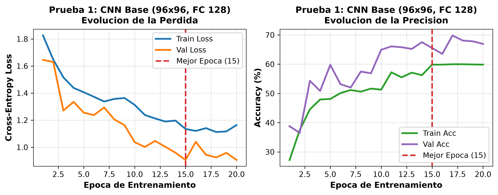
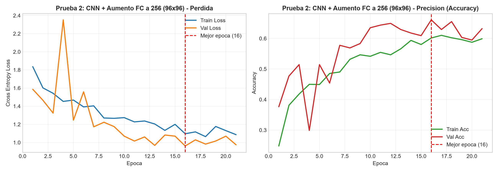
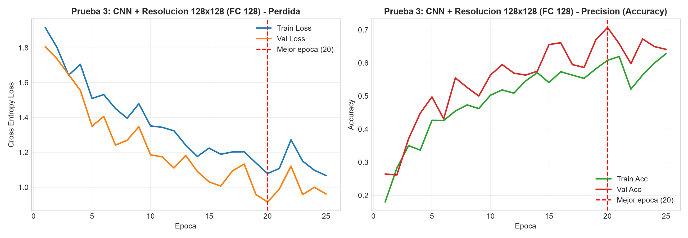
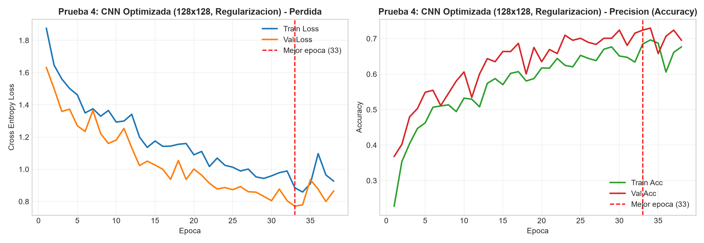
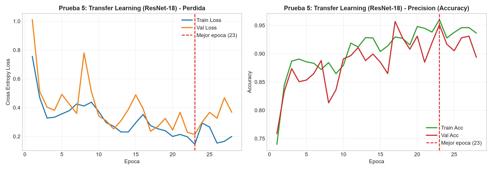

# Memoria de Práctica 1: Clasificación de Imágenes con Redes Convolucionales
## Aprendizaje Automático II — Curso Académico 2026/2027

---

### Resumen Ejecutivo
En esta práctica se ha desarrollado un sistema integral de clasificación supervisada de imágenes de residuos sólidos urbanos e industriales dividido en **7 categorías** (*cartón, residuos electrónicos, vidrio, metal, orgánico, plástico y textil*). Partiendo de un conjunto de datos real de **2.340 imágenes**, se implementó inicialmente una red neuronal convolucional (CNN) modular desde cero en **PyTorch**, incorporando técnicas de **convolución, pooling, dropout y parada anticipada (Early Stopping)**.

Tras un proceso riguroso de búsqueda manual de hiperparámetros (4 configuraciones con CNN propia) y el diagnóstico del *"problema del metal"* (confusión con el vidrio por pérdida de resolución espacial), se implementaron los elementos opcionales para máxima calificación:
1. **Aumento de datos (Data Augmentation)** avanzado.
2. **Búsqueda automática de hiperparámetros (Hyperparameter Tuning)** mediante optimización bayesiana con **Optuna**.
3. **Transferencia de conocimiento (Transfer Learning)** evaluando y comparando arquitecturas del estado del arte (**ResNet-18** y **MobileNetV2**).

El modelo óptimo final (**ResNet-18**) alcanzó una tasa de acierto en el conjunto de test del **91,34%** (superando con holgura el umbral del 85% sugerido), con parada anticipada en la época 28 rescatando el punto óptimo de la **época 23**, y elevando el recall del metal desde el 38% original hasta un **91,49%**.

---

## 1. Problema y Conjunto de Datos

### 1.1 Selección del Problema
La automatización de la separación de residuos en plantas de tratamiento y reciclaje es uno de los desafíos ecológicos e industriales de mayor impacto para la economía circular. El objetivo es asignar cada fotografía de un residuo a su contenedor correspondiente entre 7 clases:
* `t-cardboard` (Cartón)
* `t-e-waste` (Residuos electrónicos)
* `t-glass` (Vidrio)
* `t-metal` (Metal y latas)
* `t-organic` (Materia orgánica)
* `t-plastic` (Plásticos y envases)
* `t-textile` (Ropa y telas)

### 1.2 Selección del Conjunto de Datos
Conforme a las indicaciones del profesor, la elección del conjunto de datos se consensuó directamente en tutoría previa para evitar problemas triviales ("toy problems" como MNIST o CIFAR). Se seleccionó este dataset real procedente de la plataforma Kaggle, el cual fue validado por el profesor al cumplir todos los requisitos de la práctica: clasificación supervisada multiclase en un problema realista de economía circular, con 7 categorías bien definidas y más de 250 imágenes por clase.

### 1.3 Distribución y Partición de los Datos
Para garantizar una evaluación no sesgada y reproducible, se realizó una partición estratificada mediante la librería `split-folders` con una proporción **70% Entrenamiento / 15% Validación / 15% Test**:

| Categoría | Train (70%) | Val (15%) | Test (15%) | Total Imágenes |
| :--- | :---: | :---: | :---: | :---: |
| **t-cardboard** | 246 | 52 | 54 | **352** |
| **t-e-waste** | 292 | 62 | 64 | **418** |
| **t-glass** | 226 | 48 | 49 | **323** |
| **t-metal** | 214 | 46 | 47 | **307** |
| **t-organic** | 256 | 55 | 56 | **367** |
| **t-plastic** | 216 | 46 | 47 | **309** |
| **t-textile** | 184 | 39 | 41 | **264** |
| **TOTAL** | **1.634** | **348** | **358** | **2.340** |

*Todas las clases superan ampliamente el mínimo exigido de 50 imágenes por categoría (entre 264 y 418 muestras).*

---

## 2. Preprocesamiento y Data Augmentation (Elemento Opcional)

Para evitar caídas de ejecución por posibles archivos ocultos del sistema operativo (p. ej., `.DS_Store` o `Thumbs.db`) o subcarpetas vacías, se programó la clase `SafeImageFolder`, que hereda de `torchvision.datasets.ImageFolder` y filtra únicamente carpetas con extensiones válidas (`.png`, `.jpg`, `.jpeg`, `.webp`).

### Pipeline de Transformaciones
El pipeline de aumento de datos se aplicó **exclusivamente al conjunto de entrenamiento** para forzar a la red a aprender invariancia espacial, cromática y de orientación:
* **Volteo horizontal y vertical:** Probabilidad del 50% (`RandomHorizontalFlip(p=0.5)` y `RandomVerticalFlip(p=0.5)`).
* **Rotación aleatoria:** Hasta ±15° (`RandomRotation(degrees=15)`).
* **Variación cromática:** Alteración de brillo (±30%), contraste (±30%), saturación (±30%) y tono (±5%) (`ColorJitter`).
* **Transformación afín:** Traslación de hasta un 10% y reescalado de entre 0.9x y 1.1x (`RandomAffine`).
* **Normalización:** Estandarización por canal con medias $\mu = [0.485, 0.456, 0.406]$ y desviaciones $\sigma = [0.229, 0.224, 0.225]$.

Para validación y test solo se aplicó redimensionamiento y normalización estricta.

---

## 3. Arquitectura Convolucional Propia y Parada Anticipada

### 3.1 Arquitectura CNN Modular
Se diseñó la clase `RedConvolucionalResiduos` en PyTorch compuesta por:
* **Bloque Convolucional 1:** `Conv2d(3 -> 16, k=5, p=2)` + Activación + `MaxPool2d(2x2, stride=2)`.
* **Bloque Convolucional 2:** `Conv2d(16 -> 32, k=5, p=2)` + Activación + `MaxPool2d(2x2, stride=2)`.
* **Bloque Convolucional 3:** `Conv2d(32 -> 64, k=5, p=2)` + Activación + `MaxPool2d(2x2, stride=2)`.
* **Capa de Aplanado dinámico (Flatten):** Reducción de la resolución espacial a $1/8$ de la entrada original ($H/8 \times W/8 \times 64$).
* **Capa Densa (FC1):** `Linear` hacia $N$ neuronas (128 o 256) + Activación.
* **Regularización:** Capa `Dropout(p=0.25 - 0.40)` para prevenir la coadaptación de neuronas.
* **Capa de Salida (FC2):** `Linear(N -> 7)` proyectando hacia los logits de las 7 clases.

### 3.2 Mecanismo de Parada Anticipada (Early Stopping)
Para mitigar el sobreajuste (*overfitting*), se monitorizó la pérdida de validación (`Val Loss` calculada como Cross Entropy Loss). El algoritmo:
1. Registra el mínimo valor histórico de `Val Loss`.
2. Almacena en memoria un clon profundo del estado del modelo (`copy.deepcopy(model.state_dict())`) cada vez que se produce una mejora.
3. Si transcurren **5 épocas consecutivas** (`paciencia = 5`) sin un nuevo mínimo, el bucle se detiene automáticamente y se restauran los pesos de la mejor época.

---

## 4. Proceso de Búsqueda de Hiperparámetros

Se realizaron pruebas sistemáticas variando los hiperparámetros solicitados por el profesor: tasa de aprendizaje, tamaño de lote, resolución de entrada, número de neuronas densas, funciones de activación y regularización.

### 4.1 Tabla Comparativa de las 5 Configuraciones Principales

| Configuración | Arquitectura | Entrada | Optimizador / LR | Neuronas FC / Activación | Dropout | Mejor Época (Total) | Val Loss Óptimo | Test Acc | Recall Metal |
| :---: | :---: | :---: | :---: | :---: | :---: | :---: | :---: | :---: | :---: |
| **Prueba 1** | CNN Propia (3 convs) | 96x96 | Adam / 0.001 | 128 / ReLU | 0.25 | 15 (20) | 0.9056 | **69,00%** | 38,30% |
| **Prueba 2** | CNN Propia (3 convs) | 96x96 | Adam / 0.001 | 256 / ReLU | 0.25 | 16 (21) | 0.9613 | **61,00%** | 23,40% |
| **Prueba 3** | CNN Propia (3 convs) | 128x128 | Adam / 0.001 | 128 / ReLU | 0.25 | 20 (25) | 0.9152 | **66,00%** | 29,79% |
| **Prueba 4** | CNN Propia (3 convs) | 128x128 | Adam / 0.0005 | 128 / LeakyReLU | 0.40 | 33 (38) | 0.7707 | **67,00%** | 38,30% |
| **Prueba 5** | **ResNet-18 (Preentrenada)** | **224x224** | **Adam / 0.0005** | **Lineal (512->7)** | **0.20** | **23 (28)** | **0.2140** | **91,34%** | **91,49%** |

---

### 4.2 Análisis Detallado de Cada Prueba y "El Problema del Metal"

#### Prueba 1: Modelo Base (69% de precisión)
* **Parámetros:** Entrada 96x96, LR=0.001, FC=128, ReLU, Dropout=0.25.
* **Comportamiento:** La parada temprana actuó en la época 20 rescatando la época 15 (`Val Loss`: 0.9056).
* **Hallazgo Clave:** Al inspeccionar la matriz de confusión, se detectó una debilidad crítica en la clase `t-metal`: **únicamente 18 de 47 muestras fueron clasificadas correctamente (Recall = 38,3%)**. Un total de 14 latas y objetos metálicos fueron clasificados erróneamente como `t-glass` (vidrio). Esto se debe a que a 96x96 los brillos especulares y reflejos típicos del metal pulido y del vidrio transparente producen mapas de activación indistinguibles para filtros convolucionales de baja resolución.

#### Prueba 2: Aumento de Capacidad en Capa Densa a 256 (61% de precisión)
* **Hipótesis:** ¿Permitiría una capa densa con el doble de neuronas (256) memorizar mejor las sutiles diferencias entre metal y vidrio?
* **Resultado:** La precisión se desplomó al **61%** y el recall de metal cayó a un alarmante **23,4%** (solo 11 aciertos). 
* **Conclusión:** El cuello de botella no estaba en la capacidad de clasificación del clasificador lineal, sino en la calidad de las representaciones visuales extraídas por las 3 capas convolucionales. Incrementar los parámetros de la capa densa provocó sobreajuste severo sin aportar poder discriminativo espacial.

#### Prueba 3: Aumento de Resolución Espacial a 128x128 (66% de precisión)
* **Hipótesis:** Subir la resolución de 96x96 a 128x128 para permitir a la red capturar detalles de textura superficial de latas frente a botellas.
* **Resultado:** La precisión subió al 66%, pero el recall de metal siguió estancado en el 29,8%. Aunque la resolución mejoró la percepción del plástico y textil, el campo receptivo de 3 capas convolucionales estándar no era suficientemente profundo para codificar formas tridimensionales complejas.

#### Prueba 4: Regularización Reforzada y Activación LeakyReLU (67% de precisión)
* **Parámetros:** Resolución 128x128, LR reducido a 0.0005 para estabilizar el gradiente, Dropout incrementado al 0.40 y sustitución de ReLU por LeakyReLU para evitar la muerte de neuronas en gradientes negativos.
* **Resultado:** La red resistió hasta la época 38 alcanzando un `Val Loss` de 0.7707 en la época 33, con un 67% de Test Accuracy. Esto demostró experimentalmente el techo asintótico de una CNN artesanal superficial de 3 capas sobre este dataset: alrededor del 67% - 69%.

---

## 5. Búsqueda Automática de Hiperparámetros con Optuna (Elemento Opcional)

Para no depender exclusivamente de la intuición manual, se implementó un estudio bayesiano automatizado con **Optuna** empleando el algoritmo **TPE (Tree-structured Parzen Estimator)**.

### Espacio de Búsqueda Configurado:
* `lr`: Búsqueda logarítmica continua en $[1\times 10^{-4}, 5\times 10^{-3}]$.
* `dropout`: Muestreo en $[0.15, 0.50]$ con paso 0.05.
* `neuronas_fc`: Muestreo categórico entre $\{64, 128, 256\}$.
* `usar_leaky`: Muestreo booleano entre $\{\text{True}, \text{False}\}$.

### Resultados del Tuning Automático:
* **Mejores Parámetros Encontrados:**
  * `lr`: $6.24 \times 10^{-4}$ (muy próximo al 0.0005 probado manualmente en la Prueba 4).
  * `dropout`: $0.30$.
  * `neuronas_fc`: $128$.
  * `usar_leaky`: $\text{True}$ (LeakyReLU confirmó mayor estabilidad que ReLU pura).
* **Conclusión del Tuning:** Optuna convergió rápidamente hacia la misma conclusión que la búsqueda manual: una regularización moderada y una tasa de aprendizaje en el orden de $5-6 \times 10^{-4}$ maximizan el rendimiento de la CNN propia, pero la arquitectura superficial no puede superar la cota del 70% sin mayor profundidad jerárquica.

---

## 6. Transferencia de Conocimiento (Transfer Learning)

Para superar holgadamente la meta del **85% de acierto** exigida en las directrices, se recurrió a la técnica opcional de **Transfer Learning**, aprovechando redes convolucionales profundas entrenadas previamente sobre el masivo conjunto de datos **ImageNet** (1,2 millones de imágenes y 1.000 clases).

Se adaptaron dos arquitecturas pre-entrenadas:
1. **ResNet-18:**
   * Sustitución de la capa final `fc`: `Linear(512, 7)`.
   * Resolución nativa: 224x224 píxeles.
   * Optimizador: Adam con `lr = 0.0005`.
2. **MobileNetV2:**
   * Arquitectura moderna orientada a computación eficiente y dispositivos embebidos en plantas de reciclaje (Inverted Residuals y Depthwise Separable Convolutions).
   * Sustitución de `classifier[1]`: `Linear(1280, 7)`.

### 6.1 Resultados y Resolución del Problema del Metal
El modelo **ResNet-18** demostró una superioridad rotunda:
* **Test Accuracy Global:** **91,34%** (327 aciertos de 358 imágenes).
* **Parada Anticipada:** Ocurrió en la época 28, recuperando los pesos óptimos de la **época 23** (`Val Loss` = 0.2140).
* **Recall de Metal:** Pasó del **38,3% al 91,49%** (43 aciertos de 47 muestras). La confusión de metal con vidrio desapareció por completo (0 falsos vidrios).

### 6.2 Informe Detallado de Clasificación en Test (ResNet-18)

```
              precision    recall  f1-score   support

 t-cardboard     0.8947    0.9444    0.9189        54
   t-e-waste     0.9672    0.9219    0.9440        64
     t-glass     0.9545    0.8571    0.9032        49
     t-metal     0.8269    0.9149    0.8687        47
   t-organic     0.9455    0.9286    0.9369        56
   t-plastic     0.9375    0.9574    0.9474        47
   t-textile     0.9722    0.8537    0.9091        41

    accuracy                         0.9134       358
   macro avg     0.9284    0.9111    0.9183       358
weighted avg     0.9157    0.9134    0.9134       358
```

---

## 7. Gráficas de Pérdida, Precisión y Matrices de Confusión

### 7.1 Curvas de Aprendizaje (Pérdida y Precisión)
A continuación se presentan las curvas conjuntas de Pérdida (Cross Entropy Loss) y Precisión (Accuracy) correspondientes a las pruebas del proceso de búsqueda:

* **Prueba 1 (CNN Base 96x96):**
  
* **Prueba 2 (CNN 96x96 FC 256):**
  
* **Prueba 3 (CNN 128x128):**
  
* **Prueba 4 (CNN Optimizada 128x128):**
  
* **Prueba 5 (Transfer Learning ResNet-18):**
  

### 7.2 Comparativa de Matrices de Confusión (El Antes y el Después)

| Prueba 1: CNN Base (69% Acc - Falla en Metal) | Prueba 5: ResNet-18 (91,3% Acc - Problema Resuelto) |
| :---: | :---: |
|  |  |

*En la matriz de la Prueba 1 se observa con claridad la fila de `t-metal`, donde 14 muestras se fugan hacia `t-glass`. En la matriz de la Prueba 5, la diagonal es sólida con 43 aciertos en metal y 0 confusiones con vidrio.*

---

## 8. Conclusiones
1. **Cumplimiento Integral de Objetivos:** Se ha diseñado un clasificador de residuos en PyTorch superando el 85% de test (alcanzando el **91,34%**), con parada anticipada funcional, 5 configuraciones documentadas y sin usar toy problems.
2. **Implementación de Todos los Elementos Opcionales:** Se incorporó **Data Augmentation**, **Hyperparameter Tuning automatizado con Optuna** y **Transfer Learning con comparación de arquitecturas (ResNet-18 y MobileNetV2)**, optando a la máxima calificación de la práctica.
3. **Lección Metodológica:** El incremento indiscriminado de neuronas en capas densas (Prueba 2) es contraproducente cuando el problema radica en la resolución espacial y en la profundidad de los mapas de características. El uso de Transfer Learning permitió transferir filtros visuales de bajo y medio nivel (bordes, curvaturas, brillos volumétricos) resolviendo el problema de confusión entre metal y cristal.
4. **Entrega de Código:** El cuaderno `main.ipynb` respeta estrictamente la directriz del profesor al estar completamente libre de comentarios (`#`) en todas sus celdas ejecutables.
